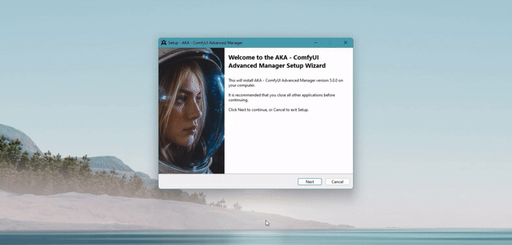
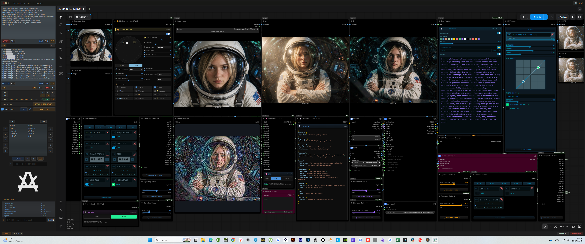

# AKA — Advanced Shell for ComfyUI

**Advanced Shell — a single shell for ComfyUI.** Creates and switches environments, installs PyTorch matched to your GPU, manages nodes, models and workflows, embeds ComfyUI right into the interface, and monitors the server in real time. Standalone exe. No Python on the host. Download — run — work.

---

## 🧙 INSTALLATION (WIZARD)

1. Download `AKA_Setup.exe` from **Releases**.
2. Run the installer, choose a folder.
3. Launch AKA. The **Wizard** will:
   - check Git and Python (registry, PATH, standard locations);
   - if anything is missing — download and install silently;
   - scan the disk for existing ComfyUI (portable / managed);
   - offer to convert a portable install or pick up an existing one;
   - create a venv with the right PyTorch for your GPU.

Portable ComfyUI conversion. If the wizard finds a portable ComfyUI install, it can convert it into a fully managed environment — keeping your models, workflows and custom nodes intact while creating a proper Python venv with the correct PyTorch build. python_embeded and old .bat launchers are left in place; you can delete them manually after conversion.

Nothing to configure by hand. If Git/Python can't be installed (no internet) — the wizard shows a FATAL screen with instructions and a RETRY button.

> **Requires:** Windows 10/11 x64, NVIDIA drivers. CUDA Toolkit and cuDNN are not needed — PyTorch ships its own libraries.

---

## 🎛 KEY FEATURES

| Block | What it does |
|---|---|
| **VENVs** | Create, clone and switch environments. Auto-selects PyTorch by GPU architecture (Blackwell → Pascal) and CUDA. Manual pip command input always available. |
| **MODELs** | Models tree, HuggingFace download with auto-resume, usage analytics (HIGH / LOW / NONE), drag & drop. |
| **NODEs** | Scan, clone, install `requirements.txt` and `install.py`, whitelist maps for launch. |
| **FLOWs** | Local workflows + sync with `Comfy-Org/workflow_templates`. New flows highlighted, one-click download. |
| **TOOLs** | System Python switching, ComfyUI update / rollback, **MASTER**, venv package manager, links. |
| **WHEELs** | Import `.whl` from disk, download by URL, install into the active venv. |
| **AKAMFY** | Embedded ComfyUI browser (WebView2) right in the center of the window. RELOAD, DEV button for DevTools. |
| **AKASHI** | Onboard computer: menu, CMD, synthesizer, voice notifications, scheduler, ARKANOID and easter eggs. |
| **Monitors** | Server Monitor (server log with WRN/ERR counters), HW Monitor (CPU/GPU/RAM/temp + **PURGE VRAM**), Progress Panel (ABORT any operation). |

---

## 🖥 WHAT IT LOOKS LIKE

Three vertical panels:
- **Left** — progress, server log, hardware, server control, AKAMFY bar.
- **Center** — tabs (MAiN / VENVs / MODELs / NODEs / FLOWs / TOOLs / WHEELs) or the embedded ComfyUI browser.
- **Right** — AKASHI, logo, Venv Console.

Top — terminal status line. Bottom — ZOOM, MINIMIZE, REFRESH, TERMINATE.

---

## 🚀 TYPICAL SCENARIO

1. **Wizard** brought everything up from scratch.
2. **VENVs → CREATE** — picked PyTorch for your GPU, waited for install.
3. **LAUNCH KEYS** — ticked the needed flags (`--windows-standalone-build`, `--enable-manager`, `--preview-method auto` are already on).
4. **SERVER START** — ComfyUI is up, log in Server Monitor, GPU temp in HW Monitor.
5. **AKAMFY >>>** — switched to the embedded ComfyUI, no external browser needed.
6. **NODEs / MODELs / FLOWs** — install nodes, download models, sync workflows.
7. Need the fresh branch? **TOOLs → MASTER**. Card overheating? **PURGE** in HW Monitor.

---

## 📁 WHERE THINGS LIVE

| Data | Path |
|---|---|
| Executable | `bin/AKA.exe` (or `AKA_Launcher.exe` in root) |
| Settings | `%APPDATA%\AKA\settings.json` |
| Path configs | `%APPDATA%\AKA\configs\paths.json` |
| Downloaded installers | `%USERPROFILE%\Downloads\AKA_downloads` |
| Wheels (`.whl`) | `%APPDATA%\AKA\wheels` |
| Flows catalog | `%APPDATA%\AKA\flows_catalog.json` |
| Browser data | `%APPDATA%\AKA\akamfy_data` |

System Python is not touched — everything is installed inside the venv in the ComfyUI folder.

---

## ⚠️ IMPORTANT NOTES

- **AKA_Launcher.exe** — splash loader: shows the loading screen, waits until the AKA window is visible and responsive, then closes itself. Can be used as the main shortcut.
- **Multiple ComfyUI installs** — just change PATH in the MAiN tab; each install has its own set of venvs.
- **ABORT** in the Progress Panel kills all operations (downloads, git, pip) but not the server. The server is stopped via **SERVER TERMINATE**.
- **HF token** is stored encrypted (Fernet, key bound to the machine).
- **Launch flags** and **active nodes map** persist between sessions.

---

## 🔗 CONTACTS

- **Telegram:** [@Rimor_Spectator](https://t.me/Rimor_Spectator)
- **GitHub:** [github.com/Rimor-dev](https://github.com/Rimor-dev)

Free, open-source project for the ComfyUI community.

---

Готово. Если захочешь ещё короче — скажи, срежу «Where things live» и «Notes» до двух строк, оставив только установку, новинки и сценарий.
